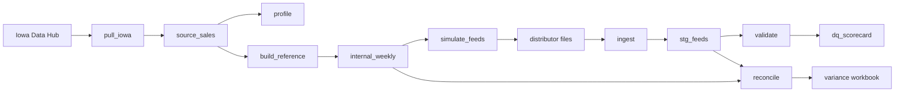

# CPG Trade Data Quality Pipeline

Real public Iowa Liquor Sales data (2023 to 2024, 5,230,532 rows) with a simulated distributor feed layer.

<!-- PULL_STATUS_START -->
Socrata resource m3tr-qhgy returned HTTP 404. Loaded 5,230,532 rows from Iowa Data Hub annual exports for 2023-01-01 to 2024-12-31 (datasets 1260 for 2023 and 1261 for 2024, the public successor to m3tr-qhgy). The annual zip files overlap across CSV parts, so exact duplicate invoice lines were removed. The kept row count matches the published dataset totals.
<!-- PULL_STATUS_END -->

## Business problem

Beverage distributors send weekly sales files that do not match the internal book of record. Sales, trade finance, and the distributors then spend the close arguing about missing weeks, duplicate lines, item codes nobody recognizes, and volumes that moved by a few percent. The internal book is the Iowa Data Hub annual export for 2023 and 2024 (datasets 1260 and 1261), not a Socrata API download. This project builds eight simulated distributor feeds with known defects and measures how much of the damage a quality and reconciliation pipeline can catch before a person opens a spreadsheet.

## Architecture



`config.yaml` holds paths, the 5% variance threshold, the 2023-01-01 to 2024-12-31 window, and random seed 42. SQLite (`data/pipeline.db`) is the shared store. SQL lives in `sql/`.

## How to run

From the project root, with the virtual environment active:

```bash
source venv/bin/activate
python run_all.py
python run_all.py --dry-run
python run_all.py --step validate
```

`--step` accepts `pull`, `profile`, `reference`, `simulate`, `ingest`, `validate`, `reconcile`, or `excel`. `--dry-run` lists the scripts and does not execute them.

The same steps, one script at a time:

```bash
python src/pull_iowa.py
python src/profile.py
python src/build_reference.py
python src/simulate_feeds.py
python src/ingest.py
python src/validate.py
python src/reconcile.py
python src/build_excel.py
```

Optional: set `SOCRATA_APP_TOKEN` if the original Socrata endpoint is reachable again. The current pull uses the Iowa Data Hub annual exports and resumes from cached zip files.

Launch the quality dashboard from the project root, after `data/pipeline.db` exists:

```bash
streamlit run dashboard/app.py
```

Build and run the container. The image includes Python 3.11 and the `sqlite3` client. The default command lists the pipeline steps and does not download data:

```bash
docker build -t cpg-trade-data-quality .
docker run --rm cpg-trade-data-quality
```

## Key results

| Result | Value |
| --- | ---: |
| Invoice lines pulled | 5,230,532 |
| Sales dollars | $893,306,076.14 |
| Liters | 47,036,977.92 |
| Validation-stage detection | 745 of 749 (99.47%) |
| Reconciliation-stage volume shifts | 4 of 4 (100.00%) |
| Overall detection, either stage | 749 of 749 (100.00%) |
| Absolute variance before cleaning | 3.60% |
| Absolute variance after cleaning | 2.82% |
| Flagged lines before cleaning | 119,714 (9.13%) |
| Flagged lines after cleaning | 96,556 (7.36%) |
| Signed variance before cleaning | -0.63% |
| Signed variance after cleaning | -1.43% |
| Flagged lines with an explained root cause | 90.64% |
| Excel workbook | 0.85 MB |

Validation catches every structural defect event (duplicates, missing weeks, unmapped codes, negative volumes, mixed dates, late files). A uniform 8 to 15 percent volume shift does not look invalid on its own. Reconciliation catches those 4 distributor weeks because the absolute week-level variance is over 5%. Absolute variance falls from 3.60% to 2.82% after cleaning, and flagged lines fall from 119,714 to 96,556. Signed variance moves from -0.63% to -1.43% because missing weeks and unmapped codes are still missing, and the duplicate copies that had been offsetting them are gone.

Detail lives in `docs/data_profile.md`, `docs/detection_results.md`, and `docs/reconciliation_results.md`. Small result copies are in `docs/sample_output/`.

## Screenshots

The live review screen is `dashboard/app.py`. Save screenshots of that app in `dashboard/` when you want them in the portfolio.

## Tech stack

- Python 3.11
- pandas, NumPy, requests, tqdm, PyYAML
- Streamlit and Plotly for the quality dashboard
- SQLite
- xlsxwriter and openpyxl for the variance workbook
- Iowa Data Hub annual exports (datasets 1260 and 1261) as the loaded source. `src/pull_iowa.py` still probes the retired Socrata resource `m3tr-qhgy`, which returns HTTP 404.

## Limitations

- `state_bottle_cost` and `state_bottle_retail` are empty on all 5,230,532 lines, so a price tie-out cannot be proven.
- Distributor files, defect logs, and the county assignment are simulated. They are not files a wholesaler sent.
- Polk County is about 10.2 million liters, so D01 is roughly twice the other distributors. Counties are not split.
- Late files are still loaded. Lateness fails the timeliness score and does not, by itself, create a volume gap, so the Timing root cause is unused in this run.
- The full reconciliation extract is about 1.3 million lines and stays in `data/output/`. The workbook uses every distributor week for totals and a 5,000 row sample for line review.
- Raw sales, feed files, the SQLite database, and `internal_weekly.csv` are gitignored because of size.
